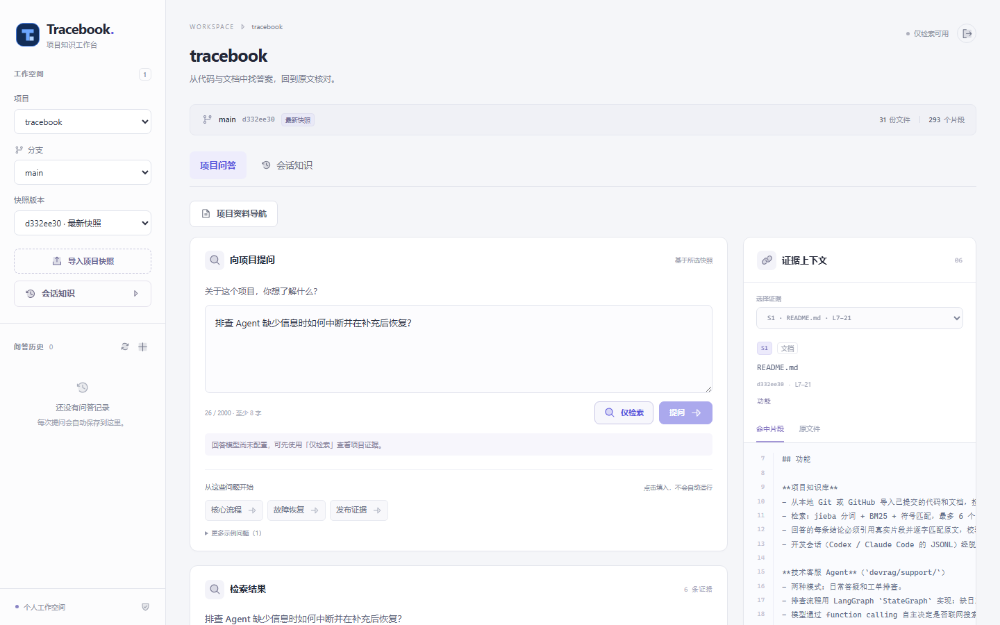

# Tracebook

把项目代码、文档和开发会话整理成带出处的知识库，供 AI 编码助手和人查阅；在此基础上提供技术客服 Agent，用项目知识回答问题和排查故障。单人项目：FastAPI + SQLite 后端，React 前端，LangGraph 编排客服流程。



## 功能

**项目知识库**
- 从本地 Git 或 GitHub 导入已提交的代码和文档，按项目、分支、提交建立快照，更新原子生效，旧回答固定在原快照；检索默认用 jieba 分词 + BM25 + 符号匹配，可用 `RETRIEVAL_METHOD` 换成向量召回、RRF 融合或融合后重排（fastembed 在本机 CPU 运行），最多 6 个片段、24,000 字符证据预算，问到"代码和文档是否一致"时沿文档里出现的符号补查实现。
- 每条结论必须引用真实片段并逐字匹配原文，校验不过不展示，证据不足时明确说不足；开发会话（Codex / Claude Code 的 JSONL）脱敏归档后可提炼候选经验。

**技术客服 Agent**（`devrag/support/`）
- 两种模式：日常答疑和工单排查。排查用 LangGraph `StateGraph`：缺日志或版本时 `interrupt` 暂停追问，补充后恢复；`SqliteSaver` 持久化检查点，服务重启后可继续。
- 模型通过 function calling 自主决定是否联网搜索：第一轮 `tool_choice=auto`，搜索后第二轮 `tool_choice=none` 综合作答；日志先脱敏（私钥、Authorization、Cookie、令牌、JWT、邮箱等）再发给模型，主备模型有限重试，答疑轻量、排查用更高推理档位，每次尝试的模型、耗时和用量都有记录。

## 环境要求

Python 3.13+、Node 24+。用 Docker 部署时宿主机不需要这两个运行时。

## 快速开始

1. 创建虚拟环境、安装 Python 依赖并构建前端（页面由后端从 `frontend/dist` 提供，未构建时首页返回 503）：
   ```powershell
   python -m venv .venv
   .venv/Scripts/python -m pip install -r requirements.txt
   npm --prefix frontend ci
   npm --prefix frontend run build
   ```
2. 设置必需环境变量：`$env:APP_PASSWORD = '<至少 16 位的访问密码>'`、`$env:SESSION_SECRET = '<至少 32 位的随机字符串>'`。长度不足会启动报错；模型变量可以不填，不配置也能导入、浏览和检索。
3. 启动服务，打开 `http://127.0.0.1:8021` 登录：
   ```powershell
   .venv/Scripts/python -m uvicorn devrag.app:create_app --factory --host 127.0.0.1 --port 8021 --workers 1
   ```

首次运行在当前目录创建 `data/`（`DATA_DIR` 可改）：`knowledge.sqlite` 主库、`worker.lock`、`developer-knowledge/` 和客服库 `support/`。示例配置见 `.env.example`；客服模块另读 `SUPPORT_*` 变量，密钥只从进程环境读取，不自动加载 `.env`。联网搜索可选自建 SearXNG（`searxng/compose.yaml`），设置 `SUPPORT_SEARXNG_URL`。

## Docker 部署

`compose.yaml` 只启动服务 `app`：镜像 `tracebook:$APP_RELEASE`，容器端口 `8000` 映射到 `127.0.0.1:8083`，数据卷 `tracebook_data` 挂到 `/data`；`APP_RELEASE` 未设置时 compose 直接报错，端口可用 `TRACEBOOK_PORT` 覆盖。`.env` 由 `env_file` 注入容器（路径可用 `TRACEBOOK_ENV_FILE` 覆盖），发布、备份和恢复见 [docs/OPERATIONS.md](docs/OPERATIONS.md)。

```powershell
Copy-Item .env.example .env   # 填入真实密钥和模型配置
$env:APP_RELEASE = '<已验证的 Git 提交>'
docker compose up -d --build
curl.exe http://127.0.0.1:8083/health
```

## 目录结构

```text
devrag/      FastAPI 应用：检索、存储、问答与客服 Agent（devrag/support/）
frontend/    React 前端，构建产物 frontend/dist
scripts/     导入、导出、评测、打包部署与知识发布脚本
docs/        OPERATIONS.md、PROJECT-GUIDE.md、images/
tests/ evaluation/ examples/ searxng/ 与顶层 Dockerfile、compose.yaml、API-CONTRACT.md、.env.example
```

## 导入自己的项目

`python scripts/inspect_repo.py C:/path/to/repo --output output/inventory.md` 生成接入建议，`python scripts/export_repo.py C:/path/to/repo --project my-project --include README.md --include src --include docs --output output/my-project.json` 生成快照 JSON，在页面"导入项目快照"上传。只读取指定提交，未提交和未跟踪文件不会进入；单份快照上限 200 个文本文件、2MB。需要持续同步时用 `scripts/sync_repositories.py`，配置示例在 `examples/`。

## 测试与评测

```powershell
python -m pytest -q
python -m ruff check devrag tests scripts
npm --prefix frontend test
python scripts/evaluate.py --bundles output/eval/bundles --output output/eval/retrieval.json
python scripts/evaluate_boundaries.py --output output/edges.json
```

`evaluation/` 里是固定在三个公开仓库提交上的 50 道检索题，题型、判分和对比方法见 `evaluation/README.md`；`--bundles` 目录放按 `corpora.json` 导出的三份快照（`<仓库名>.json`）。`--answers` 和边界评测会调用已配置的模型。`pytest` 和 `ruff` 不在 `requirements.txt` 里，需要另行安装。

### 检索评测结果

2026-11-03 在本机 CPU（AMD Ryzen 7 7745HX）上跑完 A/B/C 共 43 题。D 类和冲突题要用 `--answers` 检查模型回答，这一轮没跑。

| 方法 | hit@6 | MRR | A 点名 | B 不点名 | C 文档对照 | 耗时中位数 |
|---|---|---|---|---|---|---|
| `term-overlap` | 0.721（31/43） | 0.552 | 13/14 | 12/19 | 6/10 | 9 ms |
| `bm25-symbol`（默认） | 0.651（28/43） | 0.620 | 13/14 | 10/19 | 5/10 | 7 ms |
| `vector` | 0.651（28/43） | 0.566 | 13/14 | 11/19 | 4/10 | 24 ms |
| `hybrid` | 0.721（31/43） | 0.616 | 13/14 | 13/19 | 5/10 | 24 ms |
| `hybrid-rerank` | 0.791（34/43） | 0.684 | 13/14 | 14/19 | 7/10 | 9.1 s |

按预注册规则，主对比 `hybrid-rerank` 对 `bm25-symbol` 逐题胜 7 负 1（胜：tb07、tb14、tb15、cl10、cl13、ds05、ds06；负：ds11），双侧精确符号检验 p=0.070。胜场多于负场，但 p 不小于 0.05，所以结论是：方向上有提升，题量不足以排除偶然。

规则之外的观察：

- 提升都在 B、C 两类；A 类点名题五种方法都是 13/14。
- 只用向量对 `bm25-symbol` 胜 5 负 5，两边命中的是不同的题；融合不重排胜 5 负 2，重排在融合之上又胜 4 负 1。
- 旧的 `term-overlap` 比默认的 `bm25-symbol` 多命中 3 题（逐题胜 4 负 1，p=0.375），MRR 低一些。
- tb03、tb17、cl06、cl07、cl08、cl12 五种方法都没命中。
- 重排一次检索最慢 22.8 秒。向量类方法在每个仓库的第一题里要先给整个快照算向量（tracebook 714 个片段用了 170 秒，另两个仓库 57 秒和 38 秒），之后按片段内容的哈希缓存，对中位数影响很小。
- 第一次完整运行在重排时内存不足中止，改成逐对重排后整套重跑，见 `evaluation/README.md` 的偏差记录。

向量类方法要先装 `fastembed==0.9.1`（不在 `requirements.txt` 里），两个模型的缓存约 1.6GB，位置用 `--models-dir` 或 `FASTEMBED_CACHE_DIR` 指定；只跑前两种方法时加 `--methods term-overlap bm25-symbol`。

## 已知局限

- 默认检索不用向量。向量类方法要另装 fastembed；向量在快照第一次被检索时才计算，那次请求要一直等（tracebook 714 个片段约 3 分钟）；嵌入只看每个片段的前 512 个 token，评测语料里约 18% 的片段更长；重排每次检索约 9 秒（本机 CPU）。
- 检索没有调用图。
- 逐字引用校验只能证明引用存在，不能证明结论正确。
- 单用户、单 worker，不支持多人权限。
- 客服模块目前只接受代码里指定的模型网关和两种已验证的模型（见 `devrag/support/model.py`）。

## 文档索引

- [docs/OPERATIONS.md](docs/OPERATIONS.md)：发布状态机、备份恢复、诊断与验收门槛。
- [API-CONTRACT.md](API-CONTRACT.md)：API v1 端点与请求、响应形状。
- [.env.example](.env.example)：环境变量示例。

## 许可证

MIT，见 [LICENSE](LICENSE)。
